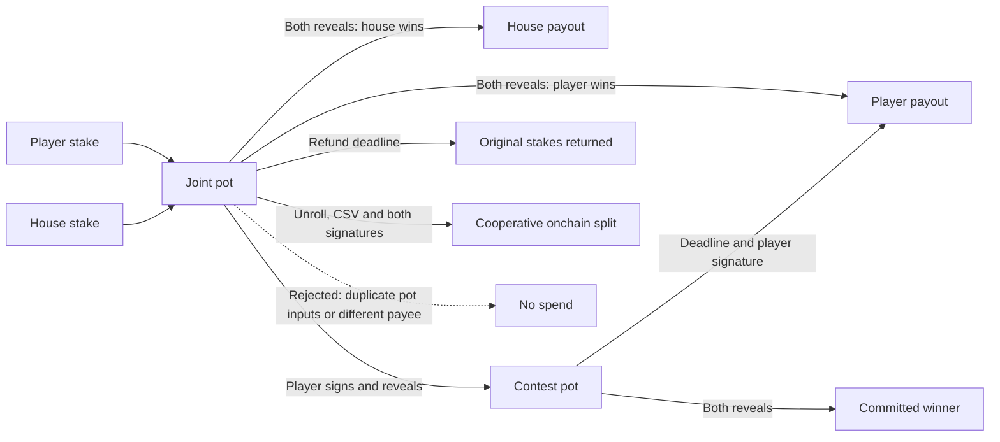
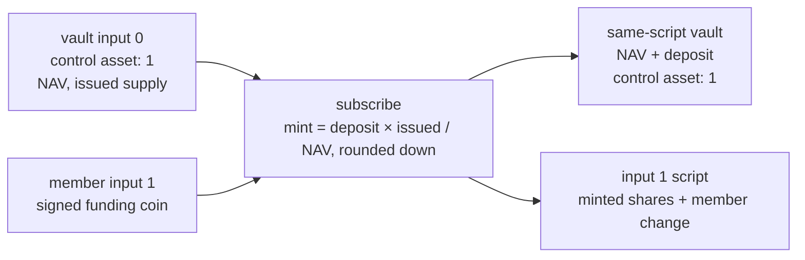
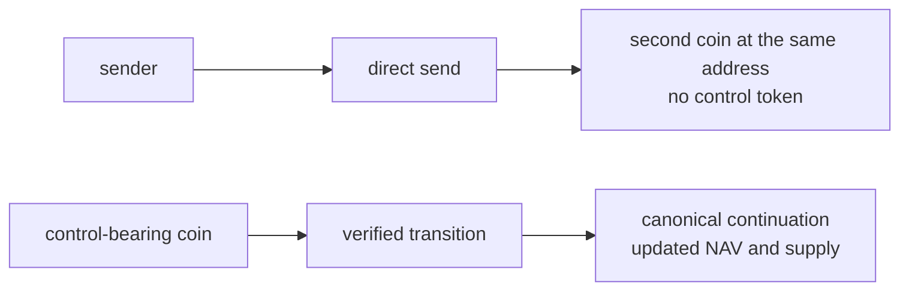
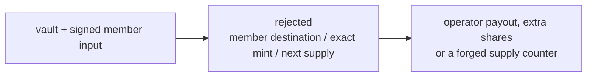
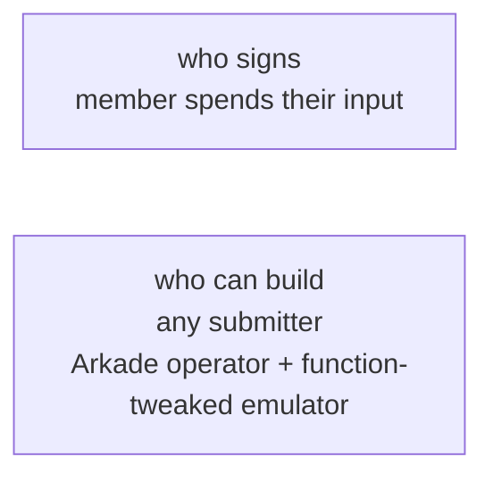
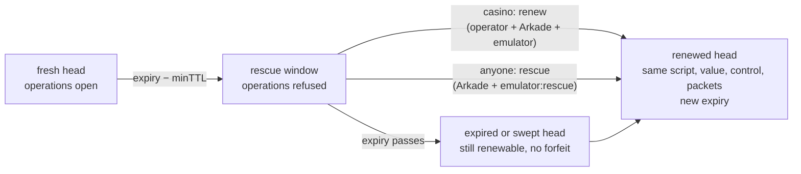
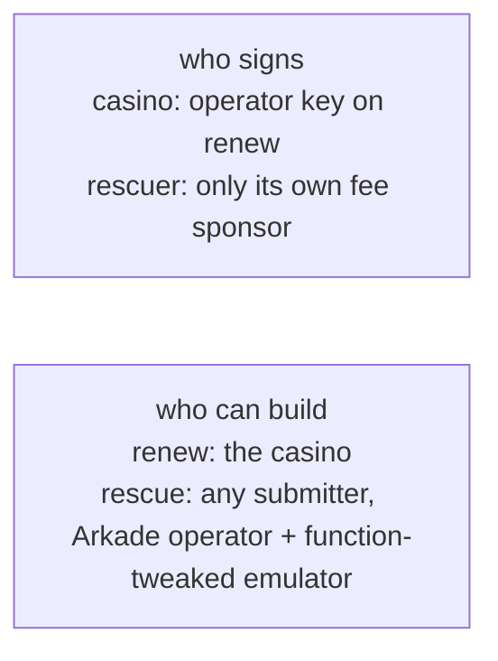

# Coinflip contracts

The normal game funds one pot atomically from the player and house. Both sides commit a secret digit before funding; revealing both secrets fixes the outcome. The compiled covenant pays the entire pot to that winner. The player may instead reveal into a contest, where the house settles honestly or the player claims the pot after the deadline. A timed refund returns both original stakes if no reveal advances the pot.

`rules.ark` binds the reveal packets, odds and exact payout amounts. Every covenant requires the pot at input zero, preventing a second pot from sharing its payout while allowing separately signed inputs to pay onchain fees. Constructor destinations are full typed scripts. The player reveal continuation is a compiled `CoinflipContest` instance; clients derive it before funding.

Collaborative paths require the Arkade Service and covenant emulator. Refund and contest timeout paths use Bitcoin CLTV leaves. The SDK preserves their deadlines in both virtual transactions and checkpoints, and the Arkade Service refuses those collaborative paths until its chain-tip timestamp reaches the deadline. CSV leaves require an aged onchain output after unroll; the counter does not start when a virtual coin is created. The cooperative exit requires both funders, and winner/forfeit exits still require the emulator. The contest has no independent operator-down exit; this matches the existing recovery model and is not a guarantee of unilateral recovery from every state.

Run `npm run contracts:build` to generate the artifacts, or `npm run contracts:check` to reproduce and compare them. `scripts/compile-contracts.mjs` pins the compiler commit and Cargo lockfile; `ARKADEC_SOURCE` may point to a clean checkout at that exact commit. The script omits `updatedAt` and normalizes embedded source line endings for reproducibility across Windows and Linux. Source, artifacts and this story must change together. Fresh installs use these contracts; previously funded scripts need their original application version.

## Experimental bankroll capital

`bankroll_vault.ark` preserves one control-bearing position. Its supply is authenticated transaction packet 32; its asset IDs are immutable constructor fields. Physical NAV is the entire vault coin. Public admission stays disabled.

The member signs their own funding input; the covenant checks the price, supply packet and exact destinations.

A direct send does not buy shares, update NAV or become the tracked position.

The transaction is refused when the output script differs from the member input, minted shares exceed the quote or packet 32 records another supply.

A `require` checks the transaction; it does not identify who may move the member's input.

Enforced: proportional subscription/redemption, preserved member carriers, exact control/share movement, stable-script continuation and full retirement. Partial redemption leaves at least 330 sats; final redemption burns control and pays all remaining NAV to the member's input script.

Not claimed: an honest unverified bootstrap, funded wagers, operator-fee enforcement, nonzero transaction fees or holder-specific recovery without the operator/emulator. See [the capital milestone](../docs/BANKROLL.md#experimental-capital-vault).

## Funded pool renewal and rescue

`pool_game_vault.ark` renews its single control-bearing head through a batch, as an unchanged continuation: same script and value, one control unit, and copied state packets. The casino renews with `renew` at any time. `rescue` has no casino key, so anyone can submit it, but only after the contract has closed new operations.

A rescue before the window is refused by the emulator because `checkTime(this.expiry - minimumTTL())` is false. A rescue that changes the value, drops the control unit or edits a state packet is refused by the same checks that `renew` uses.

Not claimed: renewal without the Arkade operator and emulator, or a shareholder Bitcoin exit.
