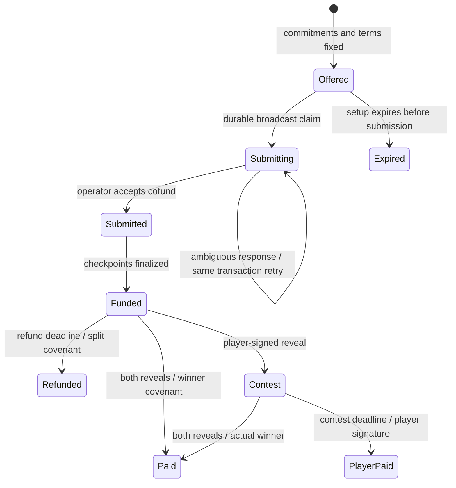

# Joint-pot protocol

This document describes the current normal game and its boundary with the adjacent community-bankroll mode. `v4` remains the normal game's wire-protocol identifier; older game modes and their recovery formats are not supported by this fresh-install rewrite. The pool uses its own covenant, state and operation journal; see [BANKROLL.md](BANKROLL.md).

## Contract source and runtime

The contract is authored in [coinflip.ark](../contracts/coinflip.ark), [contest.ark](../contracts/contest.ark) and [rules.ark](../contracts/rules.ark). The generated [pot artifact](../packages/lib/src/artifact/coinflip.json) and [contest artifact](../packages/lib/src/artifact/contest.json) include their source bundles and compiler metadata.

`npm run contracts:build` compiles them with the pinned compiler. `npm run contracts:check` recompiles and compares normalized output. [joint-pot.ts](../packages/lib/src/joint-pot.ts) and [joint-pot-stage2.ts](../packages/lib/src/joint-pot-stage2.ts) instantiate the artifacts through the SDK's `programFromArtifact` and `ArkadeProgramScript`. Spending paths are looked up by name rather than by leaf index.

The game house is not the Arkade operator. Collaborative paths require the operator and emulator; the emulator signature binds the executed covenant. Matching tapscripts add player signatures, hashlocks or timelocks where required. A covenant condition is not, by itself, authorization to spend another party's coin.

## Committed game terms

Both funders independently derive the pot using the shared [wire types](../packages/lib/src/game-types.ts). Constructor state fixes:

- Player/house keys and SHA256 commitments.
- Player/house P2TR payout scripts and original stakes.
- Odds denominator `n` and winning interval `[lo, target)`.
- Refund and contest deadlines.
- The contest continuation derived from the same terms.

The SDK program binds the operator/emulator keys and the operator-compatible CSV exit duration. Constructor validation accepts `2 <= n <= 128`, `0 <= lo < target <= n`, viable stakes and a bounded total pot. The two destinations and amounts cannot be supplied afresh when claiming a payout.

Each reveal is `digit || salt`, with a one-byte digit and at least 16 salt bytes. Extension packet 16 carries the player reveal; packet 17 carries the house reveal. Both SHA256 hashes must match the commitments. Valid digits produce:

```
roll = (houseDigit + playerDigit) mod n
playerWins = lo <= roll < target
```

An out-of-range house digit loses to the player. An out-of-range player digit loses to the house when the house digit is valid. Both invalid digits therefore resolve for the player. Missing, short or mismatched reveals fail.

`CoinflipRules.pot` requires exactly one pot input and its exact committed value. This prevents two contract inputs from reusing one payout. Each normal winner path fixes output 0's script and full-pot value.

## Funding handshake

The implementation lives in [server/v4](../packages/server/src/v4) and the pure [transaction builders](../packages/lib/src/joint-pot-tx.ts).

| Request | Result |
| --- | --- |
| `POST /api/v4/play` | Validate terms; reserve house inputs; persist a pending game; return the covenant and serialized funding inputs |
| `POST /api/v4/game/:id/cofund` | Validate the proposed pot and contributions; sign the house inputs/checkpoints and submit the cofund |
| `POST /api/v4/game/:id/cofund-finalize` | Validate the player's signed checkpoints; finalize and persist the funded pot outpoint |
| `POST /api/v4/game/:id/reveal` | Verify the player reveal, add both reveal packets and settle to the computed winner |

Player inputs precede house inputs in the cofund. Output 0 is the exact agreed pot. Each contributor must own a signing key in its input leaf. Returned checkpoints are matched by spent outpoint because response order is not stable. Wrong outpoints, count, shape or contribution amounts fail before finalization.

Subdust change is folded into that funder's committed stake before deriving the contract. The browser saves the reveal and recovery terms before submitting funding. The server atomically records `cofundSubmission` before broadcasting, claiming permission against the expiry worker. A retry may submit the same deterministic transaction; a different transaction ID is refused.

An ambiguous response keeps the input holds and protects the game from expiry, including after restart. There is no automatic worker that resolves every ambiguous submission: capacity can remain held until the client retries or an operator performs recovery. A timeout does not establish that no transaction was broadcast.



Submitted and funded games are never expired merely because their database row is old. The reconciler follows the pot/contest outpoint until its spending transaction is known.

## Pot paths

| Compiled path | Authorization and effect |
| --- | --- |
| `playerWin` | Operator + emulator; committed reveals prove player win; full pot to player |
| `creatorWin` | Operator + emulator; committed reveals prove house win; full pot to house |
| `playerReveal` | Player + operator + emulator, with player preimage; full pot to the committed contest continuation |
| `cooperativeSpend` | Operator + emulator after `cancelDelay`; original stakes returned to their committed destinations |
| `playerWinExit` | Player + emulator after CSV; same player-win covenant |
| `creatorWinExit` | House + emulator after CSV; same house-win covenant |
| `playerForfeitExit` | Player + emulator, player preimage and CSV; full pot to player |
| `cooperativeSpendExit` | Player + house after CSV; emulator-free onchain spend |

The cooperative exit builder fixes the original stake split and the fee deduction. Its HTTP endpoint validates those outputs before the house cosigns. The bare two-signature leaf itself authorizes the signers jointly; it does not independently encode that split.

## Contest paths and clocks

The contest has `playerWin` and `creatorWin` covenants with the same commitments, odds and payout scripts. `playerTakeAll` requires the player, operator and emulator after `finalExpiration`, paying the full pot to the player. This gives the house a deadline to settle the actual result after the player publishes a reveal.

Refund and contest deadlines are absolute CLTV timestamps. The transaction builders preserve their locktime and non-final sequence; the operator checks the relevant chain-tip time before cosigning. Browser countdowns do not establish maturity. The browser also enforces its own deadline safety bounds before signing and derives the trusted emulator key from the SDK's network pin or an explicit build-time override.

CSV exit delays start only after unrolling the virtual output onto Bitcoin. They do not count down from game creation. Exit durations use the operator's time domain and BIP68 encoding. Onchain confirmation and available fee funds are separate from offchain game settlement.

## Recovery and liveness

[walletRuntime.ts](../src/store/modules/ark/walletRuntime.ts) orchestrates browser recovery; the `v4ForfeitStash`, `v4SelfRefund` and `v4CooperativeExit` modules hold its persistent data and builders. Server [reconcile.ts](../packages/server/src/v4/reconcile.ts) checks contests before refunding unrevealed pots.

A restored game without the player's secret can recover that player's original stake through a split refund; it cannot invent a reveal or acquire a take-all entitlement. A restored hint must not overwrite a locally saved secret-bearing record.

Offchain refund, reveal and contest settlement require a live operator and emulator. Winner/forfeit exit leaves remove the operator but retain the emulator. The cooperative exit removes the emulator but requires both player and house. The implementation therefore does not promise an independently usable refund when the house, operator and emulator are all absent. The client cooperative-exit path remains explicitly enabled by configuration.

## Persistence and reservations

The fresh schema stores current game state in `games.state_json`, with pending/resolved/expired lifecycle status and durable cofund/settle/refund identities. Old escrow columns and migration backfills are removed.

The server uses one SDK wallet with `concurrentSpending: true`. Application game reservations also acquire SDK `reserveVtxos` holds, so SDK-selected sends and renewal avoid those inputs. Holds are per-wallet and in memory: startup must rebuild unresolved game holds before accepting plays. Known successful cofund submission retires exact input pins while retaining game liability; an ambiguous submission keeps its pins until recovery establishes its result.

The denomination planner prepares useful free funding pieces. Selection, splitting, admin self-spends and renewal share reservation exclusion. SDK holds protect coin selection; they do not replace durable game state, transaction reconciliation, or bankroll exposure limits. Run one active house process against a given wallet/database.

## Community pool boundary

`PoolGameVault` is separate from normal pots. One canonical control-bearing coin carries shared capital and authenticated supply, loss, fee and game packets through idle, funded and contest states. Member NAV excludes the operator reserve, accrued fees and busy player principal. Contributions mint proportional shares; redemptions burn member-owned shares; terminal game transactions preserve unrelated capital and pay only the committed liability. Normal funding selection excludes asset-bearing inputs.

Member capital and wagers enter through `FreshPoolInput`, a separate staging covenant with authenticated owner and payout metadata. Its owner authorization binds the complete transaction, deadline and lifetime requirement. `recoveryMargin = max(2400, nativeExitDelaySeconds + 300)` and `minInputTTL = max(6000, recoveryMargin + 3600)` bind both inputs; game funding also requires both to cover `finalAt + recoveryMargin`. The SDK rejects unsupported block-domain delays before pool issuance. The unused stage refund returns all value and shares to that owner. These are covenant checks on the participating inputs, not a promise that services or expiry recovery will always remain available.

Pool HTTP requests prepare terms and relay member-signed transactions. The coordinator atomically claims the expected head and records the exact relay before posting. Restart recovery retains input holds and reuses that transaction identity. Completion is established through actual indexed transaction/checkpoint evidence, not an HTTP response. Browser cash-release transactions and multi-coin redemptions have separately journaled steps; partial completion remains visible for explicit recovery.

The default pool policy leaves new contributions and wagers disabled. Two-party commitments enforce the bettor's agreed outcome but do not prevent an operator and bettor colluding against shareholders. Selecting the honest-operator policy makes that trust explicit; it does not add independent randomness. Existing verified idle capital and fees can be withdrawn without enabling admission.

Pool shares authorize capital redemption through the live Arkade asset ledger. They do not establish issuance lineage on Bitcoin, so there is no unilateral shareholder L1 redemption leaf. Game-specific CSV paths are a different entitlement and retain their emulator and onchain requirements. Cached verified configuration may bypass an unavailable casino HTTP coordinator for offchain redemption; it does not remove the Arkade operator or emulator dependency.

Both pool renewal leaves require the pool operator, Arkade operator and emulator, including the registration authorization. Renewal preserves the canonical continuation and its state. Public SSE replay is bounded and cannot query historical sessions: a durably captured signing aggregate can be resumed, while a missing registration UUID or a crash between nonce acknowledgment and aggregate capture may need operator recovery. Retain unresolved holds and the exact session record instead of creating a replacement intent blindly. Maximum-fee wallet renewal quotes, their fixed self output and exact proof/session/event verification remain subject to final lifecycle validation.

## Verification boundaries

The unit suites cover compiled path authorization, constructor bindings, packet handling, cofund guards, reservation conflicts and recovery bookkeeping. Live integration files exercise cofunding, actual emulator decisions, HTTP flows and delayed recovery. Artifact reproducibility and typechecking do not, by themselves, prove correct execution or production recovery. CI runs retained integration files on individual fresh stacks; fee-free regtest fixtures do not establish production fee liveness.
