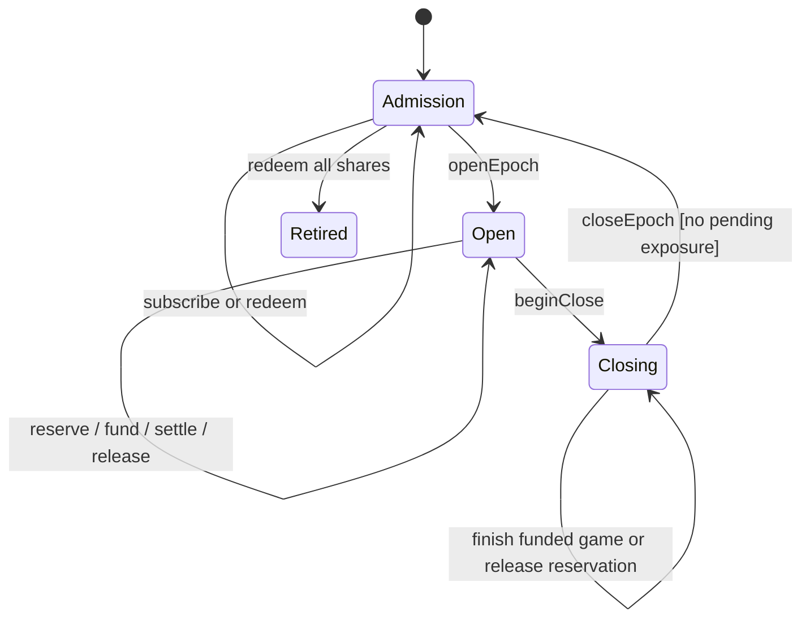
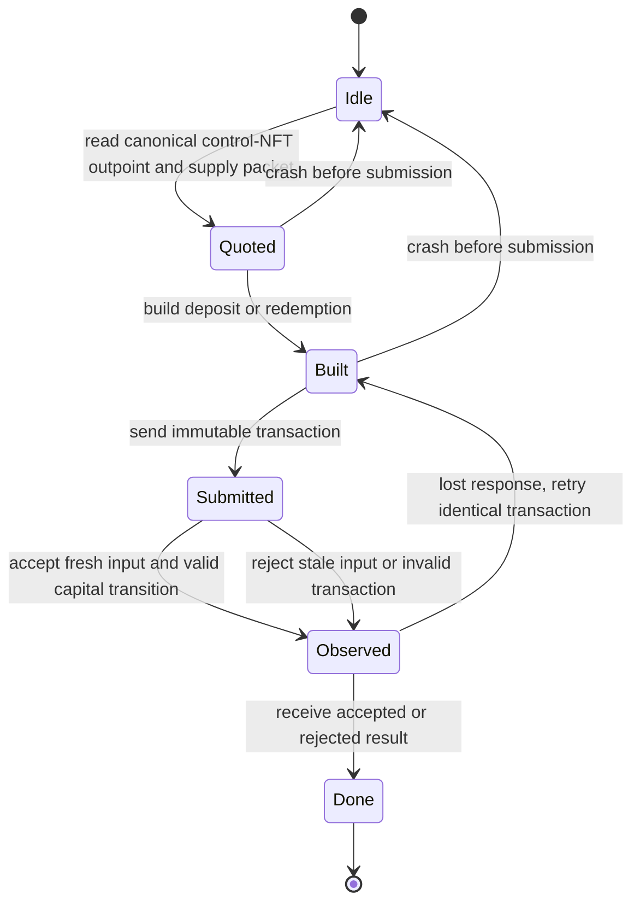
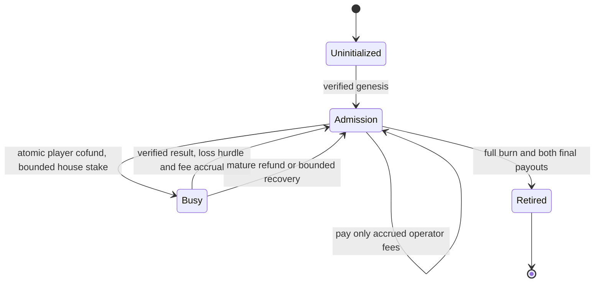
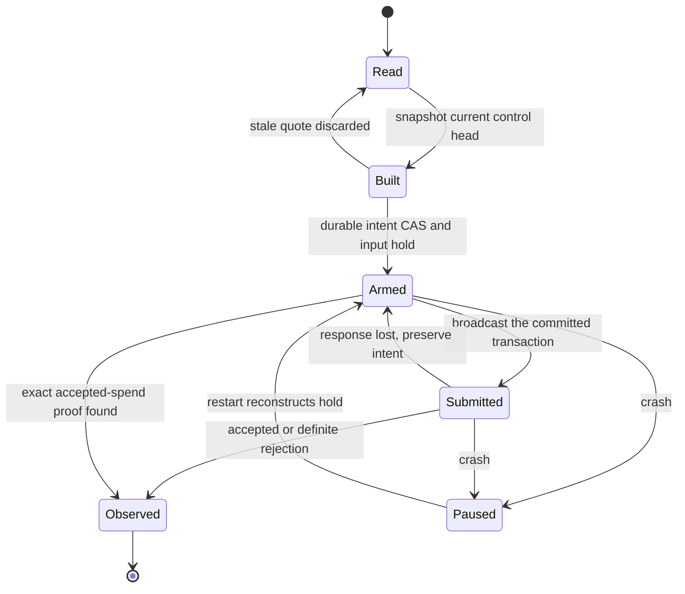
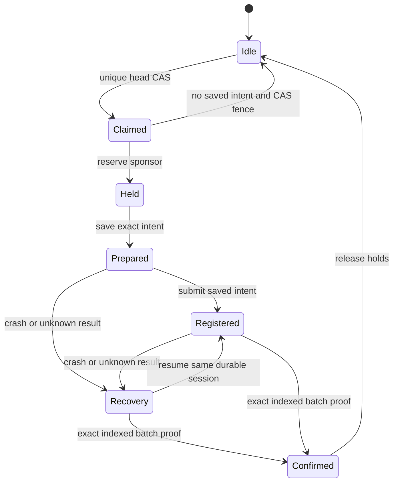
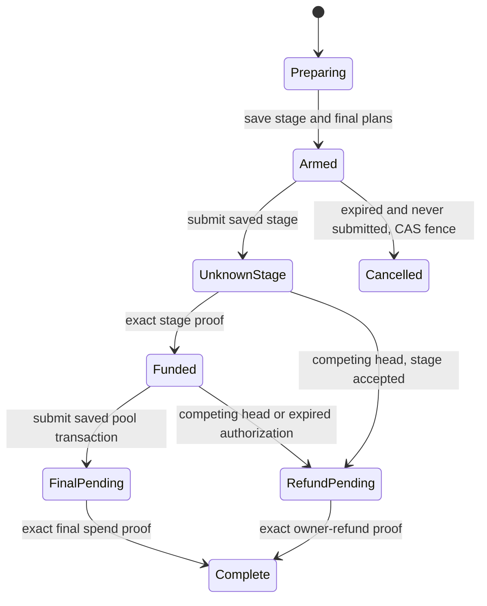

# Funding and bankroll models

## Bankroll transitions

This model covers the experimental accounting coordinator; it does not model covenant execution, cryptography, share amounts or Bitcoin finality. Reads and writes are separate actions. The future persistence layer must compare-and-swap the state version used by the pure `bankroll.ts` transition.



| Model actions | Implementation |
| --- | --- |
| ReserveRead / ReserveWrite | `reserveWager` plus a durable version compare-and-swap |
| Fund / Release | `fundWager` / `releaseWager` |
| SettleRead / SettleWrite | `settleWager` plus the same version check |
| BeginClose / Close | `beginClose` / `closeEpoch` |
| Admit | `subscribe` / `redeem` |

Checked with the host's pinned TLC runner on 2026-11-11: **10,078 distinct states**, depth 19, no invariant violations, and every action reached. The four single-guard mutations fail as expected: stale reservation writes overcommit, duplicate settlement pays twice, early close leaves exposure in admission, and open-epoch admission accepts capital while exposure remains. The sweep reports **5 configs, 0 mismatches**. A four-worker/four-wager simulation with seed 2671 checked **373,407 states** across 20,000 traces without a violation.

Run with the host `tla-model` skill runner:

```
node <tla-model>/scripts/tla.mjs check spec/tla/Bankroll --coverage --workers 2
node <tla-model>/scripts/tla.mjs sweep spec/tla --timeout 60
node <tla-model>/scripts/tla.mjs sim spec/tla/Bankroll --cfg Bankroll_Sim.cfg --num 20000 --depth 100 --seed 2671
```

The model's CAS guard is a future storage requirement, not a feature supplied by the in-memory accounting engine. It establishes bounded safety only. Crash actions drop local work; they do not model ambiguous broadcasts or prove eventual recovery. Final pool retirement and arithmetic are exercised by the executable tests instead of this state abstraction.

## Normal game funding

`NormalFunding.tla` models two workers, two offers competing for one house input, one crash/restart, and at most two submissions of the same deterministic transaction per offer. Signing, durable intent, network broadcast and response persistence are separate steps. Expiry also reads separately from its conditional write. The external service may accept or reject, while the caller may receive an ambiguous result or crash before recording it.

```mermaid
stateDiagram-v2
    [*] --> Pending: house input held
    Pending --> Expired: expiry wins atomic row update
    Pending --> Intent: pending-state CAS persists transaction identity
    Intent --> Submitted: broadcast
    Submitted --> Confirmed: accepted response persisted
    Submitted --> Held: rejected or ambiguous response
    Intent --> Held: crash before known result
    Held --> Intent: retry identical transaction
    Held --> Held: restart rebuilds exact input hold
    Confirmed --> [*]: input is spent; liability remains
```



| Model action | Owning source |
| --- | --- |
| Arm | `SQLiteGameRepository.beginCofundSubmission` in `packages/server/src/repositories/gameRepository.ts` atomically requires a pending row and the same transaction identity |
| Broadcast / Observe | `handleV4CofundInner` in `packages/server/src/v4/cofund.ts` awaits durable intent before network submission; submit errors retain intent and holds |
| ExpireRead / ExpireWrite | `SQLiteGameRepository.expirePending` atomically excludes intent, submitted and finalized games |
| Crash / Restart | `rebuildReservations` in `packages/server/src/vtxo-pool.ts` restores exact inputs for marker-only submissions; `main` awaits rebuild before listening |
| OfferRead / OfferWrite | The SDK-backed house-input holds prevent selection of a coin already claimed by another offer |

The guarded model checks **no broadcast without durable intent**, **no expiry after intent or possible funding**, **no ambiguous-input hold loss while serving requests**, and **no reuse of that input across offers**. TLC exhaustively checked **5,841 distinct states**, depth **22**, with every action reached. Five single-guard mutations produce their intended counterexamples. The combined bankroll/funding sweep reports **11 configs, 0 mismatches**. A wider four-worker/three-offer simulation with two crashes, three attempts, seed 9417 and 20,000 traces checked **1,904,661 states** without a violation.

The expiry mutation exposes this ordering:

| Step | Submission worker | Expiry worker |
| --- | --- | --- |
| 1 | Reads pending offer, then signs | |
| 2 | | Reads offer before its intent exists |
| 3 | Persists intent and may start broadcast | |
| 4 | | A stale unguarded write expires it and releases the input |

The pending-state CAS mutation exposes the reverse ordering: expiry wins while signing is in flight, then a late intent write incorrectly permits broadcast. Both guards are necessary. Restart and selection mutations separately demonstrate that durable intent must restore its hold and that the hold must actually exclude reuse.

This is bounded safety evidence, not proof of network finality or eventual recovery. The model assumes one deterministic transaction identity per offer, atomic SQLite row operations, restored holds before requests resume, and that a persisted successful submission makes the consumed input ineligible. It abstracts signatures, checkpoint validation, amounts, multiple physical coins and subsequent game settlement. The model conservatively retains markers after both explicit and ambiguous failures. The implementation additionally clears a first-attempt marker for a structured validation refusal known to precede acceptance; retries after ambiguity remain protected. That refusal classification is covered by application tests rather than this model. Neither models an automatic resolution worker or guarantees eventual recovery.

```
node <tla-model>/scripts/tla.mjs check spec/tla/NormalFunding --coverage --workers 2
node <tla-model>/scripts/tla.mjs sweep spec/tla --timeout 60
node <tla-model>/scripts/tla.mjs sim spec/tla/NormalFunding --cfg NormalFunding_Sim.cfg --num 20000 --depth 100 --seed 9417
```

Run TLC commands sequentially on this host; concurrent runs have produced a transient standard-module lookup failure. No application source is altered by these models.

## Capital vault subscriptions and redemptions

`BankrollCapital.tla` models the capital-only `BankrollVault`, separately from the wager accounting model above. Two workers each prepare one funded request. Reading the canonical position, building its transaction, submitting it, applying it on the chain and observing the response are separate actions. A bounded crash can discard local work before submission. A lost response resubmits the identical built transaction; it does not obtain a fresh quote while that transaction's outcome is unknown.



The chain's single spend of the canonical control-NFT input is the linearization point. Two valid transactions built from the same position cannot both succeed, including transactions from different members with separate unspent funding inputs. Each worker's member input is independently single-use. Rejected transactions change neither vault value nor shares. Full redemption consumes the remaining supply and retires the canonical position; the model represents retirement with zero NAV and zero supply.

| Model action or invariant | Owning source |
| --- | --- |
| Quote / DirectSend | `readBankrollVaultPosition` in `packages/lib/src/bankroll-vault.ts` selects the single live control-bearing output and authenticates its source transaction |
| Build | `buildBankrollSubscription` / `buildBankrollRedemption` in that module |
| Apply / AuthenticatedPreviousSupply | `BankrollVault.supply` in `contracts/bankroll_vault.ark` reads the authenticated previous transaction's packet 32 |
| MintProportion / RedeemProportion | `BankrollVault.subscribe` / `BankrollVault.redeem` enforce proportional integer pricing |
| SupplyConserved / AuthorizedPayout | The contract pins next supply, exact share asset changes and the member input's destination |
| SingleSpend | Chain enforcement of the consumed canonical outpoint; no application database lock is assumed |
| Initial position | `verifyBankrollBootstrap` binds the singleton control asset, controlled share genesis and initial supply |

Depositing `D` mints `floor(D * supply / NAV)` shares. Burning `B` pays `floor(B * NAV / supply)` sats from the vault. The member also receives their full carrier input back. Thus NAV plus all member payouts equals initial NAV plus deposits plus redemption carrier inputs. Supply equals the sum of members' share balances. Zero-price operations and partial redemptions leaving less than 330 sats are rejected. Both members can redeem in sequence through full retirement. A same-script direct send changes only the count of unrelated coins; it cannot purchase shares or change canonical NAV. The direct-send mutant deliberately models an incorrect discovery implementation that adds such a coin to NAV.

TLC exhaustively checked **188,434 distinct states**, depth **17**, with every action reached and no invariant violations. Seven single-guard mutations fail as intended:

| Removed guard | Violated invariant |
| --- | --- |
| Canonical input single-spend | `SingleSpend` |
| Authenticated previous supply packet | `AuthenticatedPreviousSupply` |
| Exact subscription price | `MintProportion` |
| Exact redemption price | `RedeemProportion` |
| Exact next supply packet | `SupplyConserved` |
| Member payout and subscription-share destination | `AuthorizedPayout` |
| Ignore same-script direct sends | `NAVConserved` |

The shortest stale-input counterexample is nine states. Both members quote the same control-bearing outpoint at NAV 661 and supply six. The first burns two units, receives 220 sats plus its carrier, and leaves NAV 441 with four units outstanding. Removing the single-spend guard allows the second member's stale transaction to spend that same old outpoint again. Both members have distinct funding inputs, so their independent input ownership cannot resolve this conflict.

The combined sweep reports **19 configurations, zero mismatches**. A four-worker simulation checked **644,521 states** across **20,000 traces**, depth bound **100**, seed **5239**, without a violation. The recipient-guard counterexample takes five states and redirects subscription shares to an unrelated recipient; the same guard also pins redemption payouts.

The exhaustive domain uses NAV 661 sats, three initial share units per member, deposits of 330 or 331 sats, burns of two or three units, one crash, one lost response and up to two submissions per worker. The model's supply ceiling is 1,000,000 units to fit TLC's integer evaluator; this does not change the contract's 1,000,000,000,000-unit ceiling. The wider simulation uses four workers, more amounts, two crashes, two lost responses and up to three submissions per worker.

These checks assume a valid bootstrap, unique non-reissuable control asset, share issuance restricted to its authorized control transitions, valid member signatures, authenticated previous transactions and atomic chain acceptance. They abstract scripts, packet encoding, asset-kernel validation, fees, service availability and reorganization/finality. Member minima are fixed at one positive unit in this model. Genesis validation, production-sized arithmetic and malformed transactions require the executable contract tests. There are no wager, epoch, operator-fee or profit transitions here, and no liveness or eventual recovery claim.

```
node <tla-model>/scripts/tla.mjs check spec/tla/BankrollCapital --coverage --workers 2
node <tla-model>/scripts/tla.mjs sweep spec/tla --timeout 60
node <tla-model>/scripts/tla.mjs sim spec/tla/BankrollCapital --cfg BankrollCapital_Sim.cfg --num 20000 --depth 100 --seed 5239
node <tla-model>/scripts/tla.mjs trace spec/tla/BankrollCapital --cfg BankrollCapital_SingleSpend.cfg
```

## One-game pool coordination

`PoolRuntime.tla` models the agreed one-outstanding-game `PoolGameVault` design. It is a coordination model for the new contract kernel, not evidence that a particular compiler artifact implements those rules. The contract's funded and revealed-contest phases are both represented by `busy`; authenticated outcomes and mature terminal paths are kernel assumptions. The existing capital model covers asset authority, authenticated supply and detailed subscription/redemption rules; this model adds wager exposure, realized losses, operator accrual and uncertain submission results.

The physical control coin contains `330 + NAV + accruedFees` sats while idle and adds the player's locked principal while busy. The 330-sat reserve belongs to the operator and never enters share pricing. A winning player receives at most the player's stake plus the committed house stake; a refund returns the player's principal. The rest continues in the pool. Recovery cannot sweep the whole bankroll. Full redemption burns all shares and control, pays member NAV to the member, and pays the reserve plus all accrued fees to the pinned operator destination atomically.



Two clients and two workers read and build separately. Each operation must win a durable head/version CAS before broadcasting its immutable transaction. Chain acceptance and the application's observation are separate actions. Responses can be lost, and the process can crash with a durable intent before or after acceptance. Restart must rebuild input holds before requests resume. A retry uses the same transaction identity and canonical input; it cannot silently quote against a newer head. Accepted retries are idempotent.

Bootstrap has its own durable singleton before asset issuance. Its broadcast, chain acceptance and descriptor publication are separate steps. A lost result or crash leaves bootstrap unknown; a later verified genesis proof may publish the descriptor, but an unknown first issuance cannot automatically start another share/control series. Genesis asset authority itself remains the capital model and executable tests' responsibility.



The model separates a missing indexer response from retirement. Missing data makes the displayed position unknown and releases no intent. A retired view requires a positive terminal proof and a genuinely retired canonical state. Neither missing data nor an ambiguous broadcast can authorize a new operation on the held input.

| Guard mutation | Required failure |
| --- | --- |
| `BreakCas` | More than one unresolved coordinator intent |
| `BreakIntent` | A broadcast without its durable exact transaction |
| `BreakRetry` | A retry changes the committed canonical input |
| `BreakRebuild` | Requests resume without reconstructing unresolved holds |
| `BreakAdmission` | Capital moves while a game remains locked |
| `BreakFeeHurdle` | Commission differs from realized profit after carried losses |
| `BreakFeePayout` | Operator receives more than accrued commission |
| `BreakRecoveryCap` | Recovery pays more than the wager's maximum liability |
| `BreakMissingRetired` | Missing indexer data is presented as retirement |
| `BreakBootstrap` | An unknown first issuance starts a second pool series |

| Model boundary | Owning implementation |
| --- | --- |
| Arm / quote freshness | `SQLitePoolRepository.claimOperation` and `authorizeGame` in `packages/server/src/pool/repository.ts` |
| Bootstrap singleton | `SQLitePoolRepository.beginBootstrap` before SDK issuance |
| Build / durable authorized payload | `PoolService.prepare` and `submit` in `packages/server/src/pool/service.ts`; `saveRelay` persists the exact payload before emulator POST |
| Chain acceptance | The `PoolGameVault` kernel; model arithmetic is an abstraction of its authenticated packets and canonical input |
| Observed / RecoverProof | `PoolService.reconcileOperation` plus exact `verifyPoolSubmission` chain-proof verification; only positive accepted/conflict proof releases a claim |
| Crash / Restart | Active durable head claims survive restart and must be restored before serving; `updateOperation` cannot downgrade a terminal result |

The model's global version and single live intent abstract the repository's unique active claim for a canonical `(txid, vout)` together with quote-expiry CAS. `Arm` combines a successful claim and durable immutable transaction into one boundary. The production interval between claiming, signing and saving the relay is finer grained: an executable concurrency test must refuse POST after `saveRelay` loses its active-row CAS and must preserve the first stored relay. The model does not independently establish that interval or literal quote-clock behavior. Amounts and phase always come from the authenticated chain snapshot. The model's held bit represents this durable head claim, not ownership of a shared control coin by the normal house wallet.

Additional invariants cover share conservation, physical-value and cash-flow conservation, one terminal settlement/fee application per game, and the complete burn/payment state at retirement. The small domain uses 30 sats of member NAV, a separate 330-sat operator reserve, 5-sat house exposure, 10-sat player principal and a 20% performance fee. Amounts are abstract accounting units for the coordinator; production dust, carriers and serialized asset amounts remain executable-contract obligations.

The kernel assumes valid bootstrap/asset authority, authentic committed outcomes, canonical-input single-spend, pinned payout recipients and atomic contract enforcement. The recovery action assumes an admissible mature recovery spend with the same loss cap; it does not establish a CSV ABI, unilateral holder exits or recovery with both operator and emulator offline. Normal-game funds are outside this pool's canonical coin and must remain a separate funding domain in the implementation. No liveness, finality or service-availability claim follows from a safety run.

The game and capital configurations split the operation domain to keep exhaustive enumeration bounded; the wider simulation combines both. TLC exhaustively checked **1,922,557 distinct game states**, depth **37**, and **137,629 distinct capital states**, depth **35**, without a violation. Every named transition has nonzero coverage across those two runs. The focused mutation sweep checked **10 configurations with zero mismatches**. A four-client/four-worker simulation checked **881,179 states** across **20,000 traces**, depth bound **100**, seed **7103**, without a violation.

The shortest changed-retry counterexample has 12 states. The first five initialize and verify the pool; the remainder show why a timeout must preserve the original transaction:

| State | Action | Relevant change |
| --- | --- | --- |
| 6 | Read | Worker reads canonical head 1 |
| 7 | Build | Opening transaction commits to head 1 |
| 8 | Arm | Exact transaction and head claim become durable |
| 9 | Broadcast | First attempt spends head 1 |
| 10 | Apply | Chain accepts it and advances to head 2 |
| 11 | LoseResponse | Worker cannot observe acceptance and retains the head-1 intent |
| 12 | Broadcast with `BreakRetry` | Retry silently switches to head 2; `ExactRetry` fails |

Run the model with the same host runner as above; run TLC processes sequentially on this host. A full directory sweep also includes the earlier models and reruns both exhaustive green configurations.

```
node <tla-model>/scripts/tla.mjs check spec/tla/PoolRuntime --coverage --workers 2
node <tla-model>/scripts/tla.mjs check spec/tla/PoolRuntime --cfg PoolRuntime_Capital.cfg --coverage --workers 2
node <tla-model>/scripts/tla.mjs sim spec/tla/PoolRuntime --cfg PoolRuntime_Sim.cfg --num 20000 --depth 100 --seed 7103
node <tla-model>/scripts/tla.mjs sweep spec/tla --timeout 600
node <tla-model>/scripts/tla.mjs trace spec/tla/PoolRuntime --cfg PoolRuntime_Retry.cfg
```

## Pool renewal coordinator

`PoolRenewal.tla` bounds two maintenance workers competing with a capital or game transaction for one canonical head. Its durable claim survives a lost registration response and a process restart. A fresh proof cannot replace a saved uncertain proof. Sponsor reservation and saved intent must precede the external send. The model abstracts Arkd, cryptography and the durable MuSig implementation; it makes no claim that a lost signing session can always complete.



The exhaustive run reaches 70 distinct states at depth 12; every action is reachable. Four individual guard mutations violate their named invariant. The four-worker simulation checked 141,766 states over 20,000 traces, depth 100, seed 9251. The focused sweep used a task-local copy of these five configurations to avoid rerunning unrelated models. Logs are `outputs/coinflip/pool-renewal-model-*` outside the checkout.

| Action | Owning source |
| --- | --- |
| Claim / Save / reject unsigned | `pool/repository.ts`: `claimRenewal`, `saveRenewalJournal`, `rejectUnpreparedRenewal` |
| Hold / Send / Recover / Confirm | `pool/renewal.ts`: `PoolRenewalSupervisor` |
| Normal claim | `pool/repository.ts`: `claimOperation` |

```text
node <tla-model>/scripts/tla.mjs check spec/tla/PoolRenewal --coverage
node <tla-model>/scripts/tla.mjs sim spec/tla/PoolRenewal --cfg PoolRenewal_Sim.cfg --num 20000 --depth 100 --seed 9251
```

## Staged founder redemption

`PoolStaging.tla` models the coordinator, Arkd acceptance and a competing canonical-head spend. Both the wallet-to-gate transaction and final pool transaction must be durable before staging can escape. A lost response keeps the claim and input holds. A conflicting head returns the funded gate coin to its owner before the claim can become terminal. An unsent expired plan can be fenced without funding it. Cryptographic packet checks and the separate head-claim CAS model remain assumptions here.



The exhaustive run reaches 23 distinct states at depth 10 with every action covered. All three guard mutants fail their named invariant. A bounded 20,000-trace simulation, depth 100 and seed 2049, checked 64,664 states. Logs are `outputs/coinflip/pool-staging-model-*` outside the checkout. `PoolService.operatorAction`, `PoolService.resumeOperation`, `PoolService.reconcileOperation`, `SQLitePoolRepository.claimOperation`, `SQLitePoolRepository.saveOperatorStage` and `PoolAdapter.submitOperatorStage` implement the corresponding boundaries.
